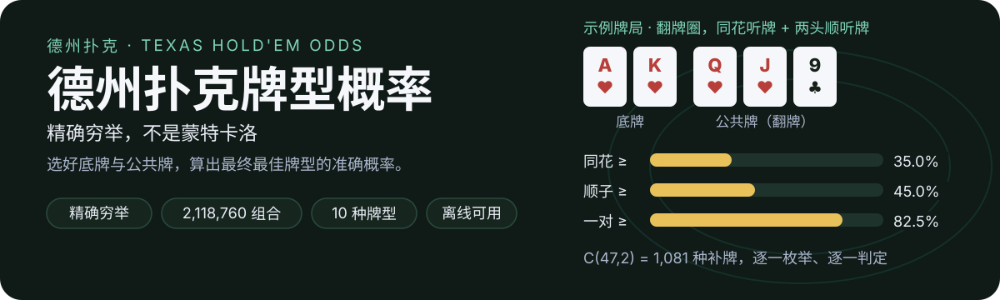
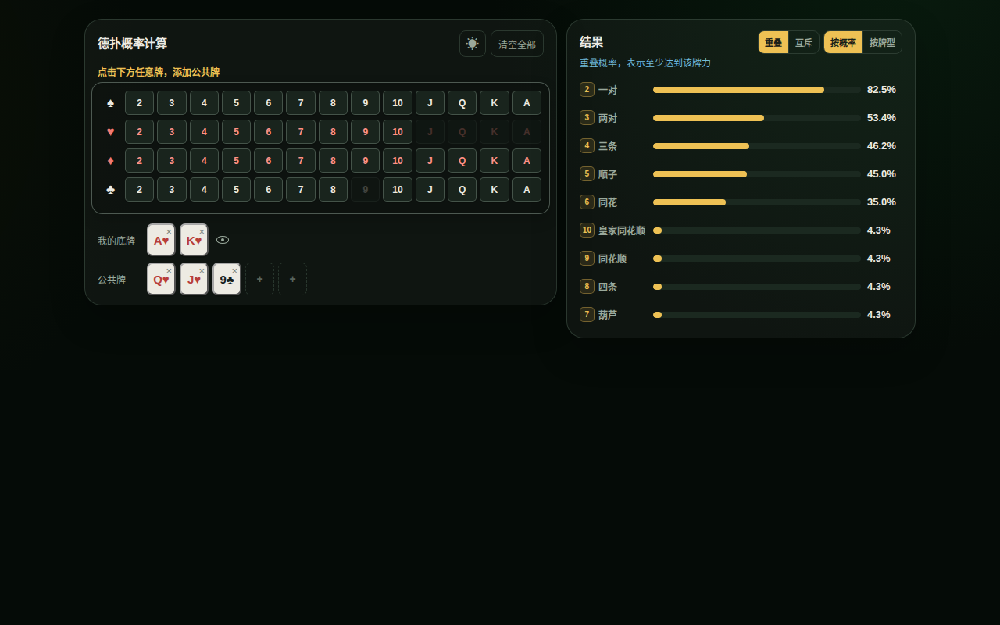

<p align="right"><a href="README.md">中文</a></p>

<p align="center">
  
</p>

<p align="center">
  <a href="https://texas-holdem-hand-probability.xiaosang.cc/">▶ Use Online</a>
  ·
  <a href="https://github.com/holynova/texas-holdem-hand-probability">GitHub Repository</a>
</p>

Texas Hold'em final hand probability calculator: pick your two hole cards and the board, and get the exact probability distribution of your final best hand once the river is dealt. No Monte Carlo — every remaining runout combination is enumerated and classified, so the numbers are exact. Computation runs locally in a Web Worker; it works offline.

## Screenshot

<p align="center">
  
</p>

## How to Use

1. Tap the cards to pick two hole cards (hidden by default — tap the eye icon to reveal), then pick 0 / 3 / 4 / 5 community cards.
2. Once the selection is complete, calculation starts automatically: all remaining runouts are enumerated, with a progress bar.
3. Results default to cumulative 「重叠」 probabilities ("at least this hand"); switch to mutually exclusive 「互斥」 probabilities (exactly this hand, summing to 100%); sort by probability or by hand strength.

## Exactness

- **Enumeration scale**: pre-flop (hole cards only) enumerates C(50,5) = 2,118,760 runouts; on the flop (3 community cards) C(47,2) = 1,081; on the turn 46; on the river the hand is classified directly.
- **10 hand types**: high card, one pair, two pair, three of a kind, straight, flush, full house, four of a kind, straight flush, royal flush — ranked 1–10 by strength.
- **Classification**: bitmask hand classifier (rank/suit masks, including the A-2-3-4-5 wheel straight and the royal-flush special case).
- **Verified**: all 9 probability rows for the screenshot hand (A♥K♥ + Q♥J♥9♣) were re-checked by re-running the enumeration independently in Node — they match.

## Run Locally

The calculator itself is a dependency-free single HTML file — just open it:

```bash
# Option 1: open public/texas-holdem-hand-probability.html directly
# Option 2: serve it statically
python3 -m http.server 8000
# Open http://localhost:8000/public/texas-holdem-hand-probability.html
```

The full app (Next.js shell) needs Node ≥ 22:

```bash
git clone https://github.com/holynova/texas-holdem-hand-probability.git
cd texas-holdem-hand-probability
npm install
npm run dev      # dev server
npm run build    # production build
```

## Tech

- Calculator: single-file HTML + vanilla JS, zero dependencies; enumeration runs in a Web Worker (worker source inlined via Blob), keeping the main thread responsive, with progress callbacks.
- Hand classification: bitmask classifier (`classify`), short-circuiting through straight flush / four of a kind / full house / flush / straight in strength order.
- Shell: Next.js 16 App Router + React 19, with the calculator HTML embedded via iframe on the home page; dark/light themes (remembered in localStorage), hole-card privacy mask, reduced-motion support.

```
public/texas-holdem-hand-probability.html   Calculator itself (single file, styles + all logic)
app/page.tsx                                Home page: calculator embedded via iframe
app/layout.tsx                              Metadata (title/description) and global styles
worker/index.ts                             Worker entry (image optimization + App Router)
vite.config.ts / next.config.ts             Build configuration
```
