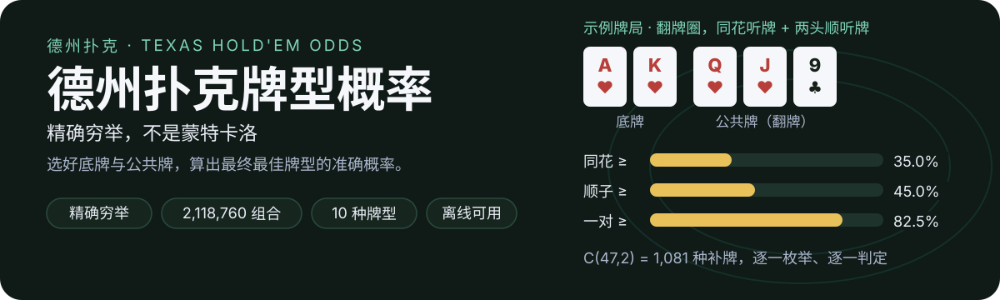

<p align="right"><a href="README.en.md">English</a></p>

<p align="center">
  
</p>

<p align="center">
  <a href="https://texas-holdem-hand-probability.xiaosang.cc/">▶ 在线用</a>
  ·
  <a href="https://github.com/holynova/texas-holdem-hand-probability">GitHub 仓库</a>
</p>

德州扑克最终牌型概率计算器：选好两张底牌与公共牌，精确算出河牌发完后最终最佳牌型的概率。不是蒙特卡洛模拟——而是把所有剩余补牌组合逐一枚举、逐一判定牌型，算出的概率是准确值。计算在浏览器本地的 Web Worker 里跑，离线也能用。

## 截图

<p align="center">
  
</p>

## 用法

1. 点牌面选两张底牌（默认隐藏显示，点眼睛图标可 reveal），再点选 0 / 3 / 4 / 5 张公共牌。
2. 选满即自动计算：剩余补牌全部枚举，进度条显示计算进度。
3. 结果默认「重叠」概率（至少达到该牌力），可切换「互斥」概率（恰好是该牌型，合计 100%）；可按概率或按牌型排序。

## 精确性

- **穷举规模**：只选底牌时枚举 C(50,5) = 2,118,760 种补牌；翻牌后（3 张公共牌）枚举 C(47,2) = 1,081 种；转牌后 46 种；河牌后直接判定。
- **10 种牌型**：高牌、一对、两对、三条、顺子、同花、葫芦、四条、同花顺、皇家同花顺，按强度 1–10 编号。
- **判定**：位掩码牌型分类（点数/花色掩码，含 A-2-3-4-5 小顺子与皇家同花顺特判）。
- **实测验证**：上图牌局（A♥K♥ + Q♥J♥9♣）的 9 行概率已用 Node 独立复跑穷举逻辑逐项核对，一致。

## 本地运行

计算器本体是零依赖的单文件 HTML，直接打开就能用：

```bash
# 方式一：直接打开 public/texas-holdem-hand-probability.html
# 方式二：起静态服务
python3 -m http.server 8000
# 打开 http://localhost:8000/public/texas-holdem-hand-probability.html
```

完整应用（Next.js 外壳）需 Node ≥ 22：

```bash
git clone https://github.com/holynova/texas-holdem-hand-probability.git
cd texas-holdem-hand-probability
npm install
npm run dev      # 开发服务
npm run build    # 生产构建
```

## 技术

- 计算器：单文件 HTML + 原生 JS，零依赖；枚举在 Web Worker 里跑（Blob 内联 worker 源码），主线程不卡，带进度回调。
- 牌型判定：位掩码分类器（`classify`），同花顺/四条/葫芦/同花/顺子按强度顺序短路判定。
- 外壳：Next.js 16 App Router + React 19，首页用 iframe 嵌入计算器 HTML；深浅主题（localStorage 记忆）、底牌隐私遮罩、减少动态偏好支持。

```
public/texas-holdem-hand-probability.html   计算器本体（单文件，含样式与全部逻辑）
app/page.tsx                                首页：iframe 嵌入计算器
app/layout.tsx                              元数据（标题/描述）与全局样式
worker/index.ts                             Worker 入口（图片优化 + App Router）
vite.config.ts / next.config.ts             构建配置
```
